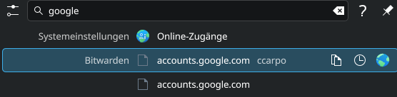

# krunner-bitwarden

A [KRunner](https://userbase.kde.org/Plasma/Krunner) plugin that lets you search your [Bitwarden](https://bitwarden.com/) vault, copy credentials to the clipboard, open URLs, and manage the vault — all without leaving your keyboard.



---

## Features

- **Search credentials** by name or username as you type
- **Multi-token narrowing** — type `paypal ccarpo` to filter by both name and username
- **Copy password** (default action on Enter)
- **Copy username** (action button)
- **Copy TOTP** code (action button)
- **Open URL** in the default browser (action button)
- **Unlock vault** via a terminal prompt window
- **Lock vault** from KRunner
- **Start / Stop** the `bw serve` API server
- **Generate passwords** with configurable presets (password, passphrase, PIN)
- Works on **Plasma 5 and Plasma 6**

---

## Requirements

| Dependency | Package (Arch/CachyOS) | Package (Ubuntu/Debian) |
|---|---|---|
| Bitwarden CLI | `bitwarden-cli` (AUR) | install via npm: `npm install -g @bitwarden/cli` |
| Python 3.8+ | `python` | `python3` |
| python-dbus | `python-dbus` | `python3-dbus` |
| python-gobject | `python-gobject` | `python3-gi` |
| A clipboard tool | `xclip` or `wl-clipboard` | `xclip` or `wl-clipboard` |
| konsole (for unlock dialog) | `konsole` | `konsole` |

---

## Installation

```bash
git clone https://github.com/ccarpo/krunner-bitwarden.git
cd krunner-bitwarden
bash install.sh
```

The script will:
1. Copy plugin files to `~/.local/share/krunner-bitwarden/`
2. Install the `.desktop` runner metadata
3. Install and enable the systemd user service
4. Write a default config (if none exists)
5. Enable the plugin in KRunner and rebuild the cache

Open KRunner (`Alt+Space`) and type any credential name. On first use, the vault will be locked — search `unlock bitwarden` and press Enter.

---

## Usage

| What you type | What happens |
|---|---|
| `paypal` | Shows all Bitwarden entries matching "paypal" |
| `paypal ccarpo` | Filters to entries matching "paypal" **and** "ccarpo" (name or username) |
| `bitwarden` | Shows vault status, lock/unlock, start/stop server |
| `unlock bitwarden` | Opens a terminal prompt to enter your master password |
| `lock bitwarden` | Locks the vault immediately |
| `generate password` | Shows password generator presets |
| `generate passphrase` | Shows passphrase generator preset |

### Actions on credential entries

After a credential appears, use the action buttons (shown on hover or Tab):

| Action | Result |
|---|---|
| **Enter** (default) | Copies the **password** to clipboard |
| Copy Username | Copies the **username** to clipboard |
| Copy TOTP | Copies the current **TOTP code** to clipboard |
| Open URL | Opens the entry's **URL** in the default browser |

---

## Configuration

The config file is created at `~/.config/krunner-bitwarden/config.ini` on first run.

```ini
[bitwarden]
# How to retrieve credentials: dynamic (recommended) or static
credential_retrieval = dynamic

# URL of the bw serve API
bitwarden_api = http://localhost:8087

# Path to the bw executable (leave empty to use bw from PATH)
bw_executable_path =

# Automatically start bw serve when the runner starts
auto_start_server = true

# How to unlock the vault: none | prompt | password_file | password_env
unlock_method = prompt

# Used when unlock_method = password_file
unlock_password_file =

# Used when unlock_method = password_env
unlock_password_env = BW_MASTER_PASS
```

### Password generator presets

Add as many `[generator.<name>]` sections as you like:

```ini
[generator.default]
type = password
length = 16
uppercase = true
lowercase = true
numbers = true
special = false

[generator.passphrase]
type = passphrase
words = 4
separator = -
capitalize = true
include_number = true
```

After editing, restart the service:

```bash
systemctl --user restart krunner-bitwarden
```

---

## Service management

```bash
# Status
systemctl --user status krunner-bitwarden

# Restart after config changes
systemctl --user restart krunner-bitwarden

# Stop
systemctl --user stop krunner-bitwarden

# Disable autostart
systemctl --user disable krunner-bitwarden
```

---

## Uninstallation

```bash
bash uninstall.sh
```

Your config at `~/.config/krunner-bitwarden/` is preserved. Remove it manually if desired:

```bash
rm -rf ~/.config/krunner-bitwarden
```

---

## Troubleshooting

### Plugin not appearing in KRunner

1. Make sure the service is running:
   ```bash
   systemctl --user status krunner-bitwarden
   ```
2. Verify the DBus service responds:
   ```bash
   qdbus6 --literal org.kde.krunner.bitwarden /runner org.kde.krunner1.Match "test"
   ```
3. Rebuild the KRunner cache and restart:
   ```bash
   kbuildsycoca6 --noincremental
   kquitapp6 krunner
   ```
4. Ensure the plugin is enabled in **System Settings → Search → Plasma Search**.

### Only one result shown

KRunner collapses lower-ranked categories to a single entry. Bitwarden results use the highest category relevance, so they should expand fully. If they appear near the bottom, it means another runner produced a higher-scoring result for that query.

### Vault stays locked after unlock

The `bw serve` API must be running before you unlock. Check with:
```bash
curl -s http://localhost:8087/status | python3 -m json.tool
```

### `bw` not found

Set the full path in config:
```ini
bw_executable_path = /home/youruser/.local/bin/bw
```

---

## Architecture

```
krunner-bitwarden/
├── bitwarden_runner.py          # Main DBus service / KRunner plugin
├── bitwarden_unlock_helper.py   # Terminal helper for vault unlock
├── plasma-runner-bitwarden.desktop  # KRunner plugin metadata
├── krunner-bitwarden.service    # systemd user service
├── config.ini                   # Default configuration template
├── install.sh                   # Installation script
└── uninstall.sh                 # Uninstallation script
```

The plugin exposes the `org.kde.krunner1` DBus interface on `org.kde.krunner.bitwarden /runner`. KRunner discovers it via the `.desktop` file in `~/.local/share/krunner/dbusplugins/` (Plasma 6) or `~/.local/share/kservices5/` (Plasma 5).

---

## License

MIT — see [LICENSE](LICENSE)
